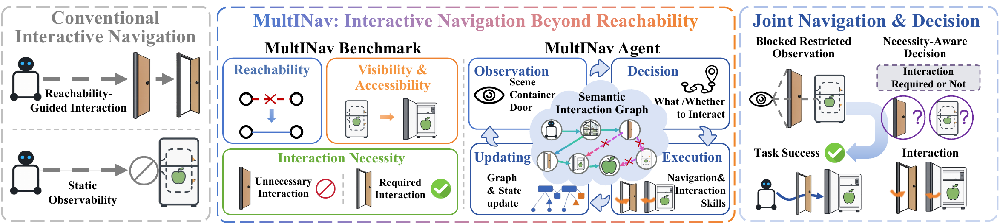

# MultINav

**Interactive navigation environment and evaluation.**

MultINav benchmarks navigation in indoor scenes where articulated objects — doors,
sliding doors and gate-like barriers, fridges, cabinets and drawers — change the
structure of the navigable space.

## Overview



*Existing interactive navigation focuses on reachability or route efficiency, overlooking
interaction necessity and the ability to improve target observability. We propose the
MultINav benchmark and agent to enable efficient and purposeful interactions in navigation.*

**Interactive Navigation Beyond Reachability: Benchmark and Agentic Framework** —
[homepage](https://zgca-hmi-lab.github.io/MultINav/) ·
[paper](https://arxiv.org/pdf/2610.17089) ·
[code](https://github.com/ZGCA-HMI-Lab/MultINav) ·
[dataset](https://huggingface.co/datasets/Piqiuni/MultINav-Bench)

Opening a door restores a blocked route, but opening a fridge, a cabinet or a drawer changes
what the robot can see and reach — and many of the interactions a scene affords are not worth
performing at all. MultINav covers both sides of that decision:

- **MultINav-Bench** — a 3,000-episode ObjectGoal benchmark that pairs *channel* interactions
  (reachability) with *container* interactions (target visibility and accessibility), annotates
  whether an interaction is necessary, and scores navigation success together with
  interaction-process effectiveness.
- **MultINav-Agent** — a three-stage framework over a state-conditioned semantic interaction
  graph: semantic interactive perception grounds rooms, interaction states and expected effects;
  a vision-language model selects the interaction-navigation action; execution outcomes verify
  state transitions, update graph relations and trigger replanning.

Both are evaluated against a non-interactive *Pure Navigation* baseline.

## This repository

This repository contains the **incremental** interactive navigation layer: the
simulator-facing environment hooks, the `interactive_nav_v3` episode contract, and the
standalone evaluator. The simulators themselves are external dependencies. Each episode
tells a policy *when* an interaction is worth performing, not only *how*, by attaching
interactive objects, their state (`unknown` / `closed` / `open`), interaction cost and
state transitions to the scene topology.

## Layout

| Path | Contents |
|---|---|
| `src/multinav/core/` | Episode contract, articulation math, deferred simulator access |
| `src/multinav/platforms/` | Platform seam: the only interface a simulator must implement |
| `src/multinav/platforms/molmospaces/` | MolmoSpaces adapter (MuJoCo) |
| `src/multinav/sim/` | Simulator-side interaction runtime and V3 episode model |
| `src/multinav/evaluation/` | Standalone benchmark runner, metrics and policies |
| `src/multinav/collection/` | Ground-truth trajectory collection helpers |
| `benchmarks/` | Episode schema, dataset card and small examples |
| `docs/` | Architecture, extraction manifest, evaluation protocol |

## Install

Python 3.11 is required. The episode contract, articulation math and scoring
core import with `pip install -e .`; a simulator is only needed to run an
episode.

```bash
pip install -e .
```

MolmoSpaces is an external dependency of the environment adapter:

```bash
pip install -e ".[molmospaces]"
```

An Isaac Sim adapter is planned; see `docs/architecture.md`.

## Benchmark

`MultINav-Bench` is published on Hugging Face:
[`Piqiuni/MultINav-Bench`](https://huggingface.co/datasets/Piqiuni/MultINav-Bench)
(3,000 episodes: 1,000 channel, 1,000 container, 1,000 mixed).

Only the schema, the dataset card and small examples are tracked here; the
episode archives live on the Hub:

```bash
hf download Piqiuni/MultINav-Bench --repo-type dataset --local-dir benchmarks/data
```

[`benchmarks/dataset_card.md`](benchmarks/dataset_card.md) is the card published
with the release, including the episode format, the statistics and the metric
definitions.

## Evaluate

```bash
multinav-eval --benchmark benchmarks/data/v1.2/benchmark/benchmark.json --policy <name>
```

See `docs/evaluation_protocol.md` for metric definitions and
`docs/architecture.md` for the platform seam.

## License

Apache 2.0. See `LICENSE` and `NOTICE`; this work builds on
[MolmoSpaces](https://github.com/allenai/molmospaces) by the Allen Institute for AI.
